# Lab 3: REST API, Query Parameters, Validation, and Debugging

**Live URL**: *Pending deployment.*

---

## 1. Project & Academic Metadata

| Attribute | Details |
| :--- | :--- |
| **Lab Number** | Lab 03 |
| **Project Title** | REST API, Query Parameters, Validation, and Debugging |
| **Course** | Backend Development Fundamentals |
| **Academic Year** | Year II, Term II |
| **Institution** | Aurora |
| **Faculty Mentor** | Joel Prashanth D |
| **Student Name** | Dayyala Naresh |
| **Registration Number** | 252U1R9029 |
| **Branch & Specialization** | CSE – Artificial Intelligence & Machine Learning (Gen AI) |

---

## 2. Project Overview & Objectives

In modern web architecture, building scalable RESTful services requires more than basic CRUD functionality. Real-world client applications demand flexible data retrieval mechanisms—including keyword searching, dynamic sorting, pagination, and multi-field range filtering. Additionally, server reliability depends on defensive input validation to guard against corrupted state, unhandled runtime exceptions, and security vulnerabilities like SQL Injection.

This project delivers a production-ready, beginner-friendly REST API for an institutional Book Directory, developed using **Node.js**, **Express.js**, and an embedded **SQLite** relational database.

### Core Objectives:
1. **Dynamic Query Parameters**: Implement robust handling for `search_q`, `order_by`, `order`, `limit`, `offset`, `min_price`, and `max_price`.
2. **Defensive Validation & Security**: Validate incoming payloads and query parameters using strict column allowlists and 100% parameterized SQL statements (`?` placeholders) to prevent SQL injection.
3. **Automated Database Lifecycle**: Ensure zero manual setup; the application automatically verifies schema existence on boot and seeds initial records.
4. **Predictable Status Codes**: Deliver standard HTTP response codes (`200 OK`, `201 Created`, `400 Bad Request`, `404 Not Found`, `500 Internal Server Error`).
5. **Backend Debugging Literacy**: Document common Node.js and SQLite runtime bugs (`EADDRINUSE`, module path errors, table typos, and missing `await` statements) for viva preparation.

---

## 3. Technology Stack

| Technology | Purpose in Lab 3 |
| :--- | :--- |
| **Node.js** (v22 LTS) | Asynchronous event-driven JavaScript runtime executing server logic. |
| **Express.js** (v4.21+) | Minimalist web application framework providing routing, JSON middleware, and error handling. |
| **SQLite3** & **sqlite** | Embedded serverless relational database engine paired with a modern Promise wrapper for clean `async/await` syntax. |
| **Postman** | Industry-standard API development environment used for sending HTTP requests and validating response schemas. |
| **Git & GitHub** | Version control tracking changes without interfering with prior lab directories (`LAB 1` and `LAB 2`). |
| **Render** | Cloud hosting platform for automated containerized deployment. |

---

## 4. Project Directory Structure

```text
LAB 3/
├── screenshots/               # Postman execution proof and DB verification captures
│   ├── .gitkeep               # Git directory tracking placeholder
│   ├── get-all-books.png      # [Captured & Verified]
│   ├── search-books.png       # [Captured & Verified]
│   ├── sort-books.png         # [Captured & Verified]
│   ├── pagination.png         # [Captured & Verified]
│   ├── price-filter.png       # [Captured & Verified]
│   ├── get-book-by-id.png     # [Captured & Verified]
│   ├── post-create-book.png   # [Captured & Verified]
│   ├── post-validation-error.png # [Captured & Verified]
│   ├── put-update-book.png    # [Captured & Verified]
│   ├── delete-book.png        # [Captured & Verified]
│   ├── not-found-error.png    # [Captured & Verified]
│   └── database-verification.png # [Captured & Verified]
├── .gitignore                 # Excludes node_modules/, .env, and logs
├── .node-version              # Enforces Node.js 22 LTS on cloud build systems
├── app.js                     # Express server, route controllers, and validators
├── database.js                # SQLite initialization and connection provider
├── database.db                # Auto-generated SQLite database file
├── initDB.sql                 # DDL schema definition and 12 seed records
├── package.json               # Dependencies, scripts, and minimatch security overrides
├── package-lock.json          # Deterministic dependency tree (0 audit vulnerabilities)
└── README.md                  # Comprehensive academic lab documentation
```

---

## 5. Database Schema & Automatic Initialization

The application persists data in an embedded SQLite database (`database.db`) using the `books` table.

### Schema Definition (`initDB.sql`)

```sql
CREATE TABLE IF NOT EXISTS books (
  id INTEGER PRIMARY KEY AUTOINCREMENT,
  title TEXT NOT NULL,
  author TEXT NOT NULL,
  price REAL NOT NULL,
  pages INTEGER
);
```

### Table Structure

| Column Name | Data Type | Constraints | Description |
| :--- | :--- | :--- | :--- |
| `id` | `INTEGER` | `PRIMARY KEY AUTOINCREMENT` | Unique identifier generated sequentially by SQLite. |
| `title` | `TEXT` | `NOT NULL` | The full title of the book. Required. |
| `author` | `TEXT` | `NOT NULL` | Author name or writing team. Required. |
| `price` | `REAL` | `NOT NULL` | Book price in currency units (decimal/float). Must be $\ge 0$. |
| `pages` | `INTEGER` | Optional | Total number of book pages. Must be positive if supplied. |

### Automatic Database Initialization (`database.js`)
When `app.js` starts, it invokes `initializeDB()` from `database.js`. The function queries SQLite's internal metadata catalog (`sqlite_master`):
1. If the `books` table does **not** exist, it reads `initDB.sql` and executes `db.exec(initSQL)`, automatically creating the table and populating it with 12 classic computer science titles (such as *The Pragmatic Programmer*, *Clean Code*, and *Introduction to Algorithms*).
2. If the table already exists, it verifies connectivity and logs the current record count.
3. **No manual DB creation is ever required.**

---

## 6. Installation & Local Setup

### Prerequisites
- Node.js (version 20.x or 22.x LTS recommended)
- npm (Node Package Manager)

### Step-by-Step Instructions

1. **Navigate to the `LAB 3` directory**:
   ```bash
   cd "LAB 3"
   ```

2. **Install project dependencies**:
   ```bash
   npm install
   ```

3. **Start the application**:
   - Production mode:
     ```bash
     npm start
     ```
   - Development mode (with live reload via nodemon):
     ```bash
     npm run dev
     ```

4. **Verify startup in terminal**:
   ```text
   Database connected. Current books in table: 12
   Server Running at http://localhost:3000/
   Listening on all network interfaces (0.0.0.0:3000) for deployment compatibility.
   ```

5. **Test in browser or Postman**:
   Visit: `http://localhost:3000/`

---

## 7. REST API Endpoints Specification

| HTTP Method | Route | Description | Query Parameters Supported | Success Code |
| :---: | :--- | :--- | :--- | :---: |
| `GET` | `/` | API Welcome message & endpoint directory | None | `200 OK` |
| `GET` | `/books` | Retrieve books with filtering, sorting & pagination | `search_q`, `order_by`, `order`, `limit`, `offset`, `min_price`, `max_price` | `200 OK` |
| `GET` | `/books/:id` | Retrieve single book by unique ID | None | `200 OK` |
| `POST` | `/books` | Create a new book record | None (Accepts JSON body) | `201 Created` |
| `PUT` | `/books/:id` | Update an existing book record | None (Accepts JSON body) | `200 OK` |
| `DELETE` | `/books/:id` | Remove a book record by ID | None | `200 OK` |

---

## 8. Query Parameters Guide (`GET /books`)

The `GET /books` endpoint supports 7 query parameters that can be used individually or combined:

### 1. `search_q` (Text Search)
- **Purpose**: Performs a case-insensitive substring search on the `title` column using SQL `LIKE ?`.
- **Example**: `/books?search_q=JavaScript`
- **Implementation**: Parametrized as `title LIKE ?` with value `'%JavaScript%'`.

### 2. `order_by` (Sort Field)
- **Purpose**: Specifies the column by which records are sorted.
- **Allowed Values (Allowlist)**: `id`, `title`, `author`, `price`, `pages`.
- **Default**: `id`.
- **Security Note**: SQL column names cannot be parameterized with `?`. Therefore, the server validates user input against an explicit array allowlist (`ALLOWED_SORT_COLUMNS`). Any unrecognized value immediately returns `400 Bad Request`.

### 3. `order` (Sort Direction)
- **Purpose**: Controls sorting sequence.
- **Allowed Values**: `ASC` (ascending) or `DESC` (descending).
- **Default**: `ASC`.
- **Validation**: Rejects any value other than `ASC` or `DESC` with `400 Bad Request`.

### 4. `limit` (Page Size)
- **Purpose**: Restricts the maximum number of records returned.
- **Allowed Values**: Positive integers ($> 0$).
- **Default**: `10`.
- **Validation**: If `limit` is zero, negative, or non-numeric, returns `400 Bad Request`.

### 5. `offset` (Page Offset)
- **Purpose**: Skips a specified count of records before collecting results (used for pagination).
- **Allowed Values**: Non-negative integers ($\ge 0$).
- **Default**: `0`.
- **Validation**: If `offset` is negative or non-numeric, returns `400 Bad Request`.

### 6. `min_price` (Lower Price Boundary)
- **Purpose**: Filters books with `price >= min_price`.
- **Validation**: Must be a non-negative number. Returns `400 Bad Request` if invalid.

### 7. `max_price` (Upper Price Boundary)
- **Purpose**: Filters books with `price <= max_price`.
- **Validation**: Must be a non-negative number. If both `min_price` and `max_price` are provided and `min_price > max_price`, returns `400 Bad Request` (`'min_price' cannot be greater than 'max_price'`).

---

## 9. Request & Response Examples

### A. Welcome Route
- **Request**: `GET http://localhost:3000/`
- **Response (`200 OK`)**:
  ```json
  {
    "message": "Welcome to Lab 3 REST API - Books Directory",
    "student": {
      "name": "Dayyala Naresh",
      "registrationNumber": "252U1R9029",
      "course": "Backend Development Fundamentals",
      "faculty": "Joel Prashanth D"
    },
    "endpoints": {
      "GET /": "API welcome message and documentation",
      "GET /books": "Retrieve books with optional query filters (search_q, order_by, order, limit, offset, min_price, max_price)",
      "GET /books/:id": "Retrieve a single book by ID",
      "POST /books": "Create a new book record",
      "PUT /books/:id": "Update an existing book record",
      "DELETE /books/:id": "Delete a book record by ID"
    }
  }
  ```

---

### B. Retrieve Books with Combined Filters
- **Request**: `GET http://localhost:3000/books?search_q=Code&order_by=price&order=ASC&min_price=100&max_price=1000`
- **Response (`200 OK`)**:
  ```json
  [
    {
      "id": 2,
      "title": "Clean Code: A Handbook of Agile Software Craftsmanship",
      "author": "Robert C. Martin",
      "price": 650,
      "pages": 464
    }
  ]
  ```

---

### C. Create a Book (POST `/books`)
- **Request**: `POST http://localhost:3000/books`
- **Headers**: `Content-Type: application/json`
- **Body**:
  ```json
  {
    "title": "JavaScript Basics",
    "author": "John Smith",
    "price": 399,
    "pages": 250
  }
  ```
- **Response (`201 Created`)**:
  ```json
  {
    "message": "Book created successfully",
    "book": {
      "id": 13,
      "title": "JavaScript Basics",
      "author": "John Smith",
      "price": 399,
      "pages": 250
    }
  }
  ```

---

### D. Input Validation Failure (POST `/books` with negative price)
- **Request**: `POST http://localhost:3000/books`
- **Body**:
  ```json
  {
    "title": "Invalid Pricing",
    "author": "Anonymous",
    "price": -50,
    "pages": 100
  }
  ```
- **Response (`400 Bad Request`)**:
  ```json
  {
    "message": "Price must not be negative"
  }
  ```

---

### E. Update a Book (PUT `/books/:id`)
- **Request**: `PUT http://localhost:3000/books/13`
- **Headers**: `Content-Type: application/json`
- **Body**:
  ```json
  {
    "title": "JavaScript Basics (2nd Edition)",
    "author": "John Smith",
    "price": 449,
    "pages": 280
  }
  ```
- **Response (`200 OK`)**:
  ```json
  {
    "message": "Book updated successfully",
    "book": {
      "id": 13,
      "title": "JavaScript Basics (2nd Edition)",
      "author": "John Smith",
      "price": 449,
      "pages": 280
    }
  }
  ```

---

### F. Delete a Book (DELETE `/books/:id`)
- **Request**: `DELETE http://localhost:3000/books/13`
- **Response (`200 OK`)**:
  ```json
  {
    "message": "Book deleted successfully"
  }
  ```

---

### G. Resource Not Found (GET `/books/9999`)
- **Request**: `GET http://localhost:3000/books/9999`
- **Response (`404 Not Found`)**:
  ```json
  {
    "message": "Book not found"
  }
  ```

---

## 10. Postman Testing Guide

To test the application using Postman, ensure the server is running locally on port 3000 (`npm start`). Use the test matrix below to execute and verify each scenario:

| # | Test Scenario | HTTP Method | URL | Headers / Body | Expected Status | Expected Verification |
| :-: | :--- | :---: | :--- | :--- | :---: | :--- |
| **1** | Get All Books (Default) | `GET` | `http://localhost:3000/books` | None | `200 OK` | Array of 10 books (`limit=10` default). |
| **2** | Search by Partial Title | `GET` | `http://localhost:3000/books?search_q=Java` | None | `200 OK` | Only books containing "Java" in title. |
| **3** | Sort by Price Ascending | `GET` | `http://localhost:3000/books?order_by=price&order=ASC` | None | `200 OK` | Lowest priced book appears first. |
| **4** | Sort by Price Descending | `GET` | `http://localhost:3000/books?order_by=price&order=DESC` | None | `200 OK` | Highest priced book appears first. |
| **5** | Pagination (Limit & Offset) | `GET` | `http://localhost:3000/books?limit=3&offset=2` | None | `200 OK` | Exactly 3 books returned, starting from 3rd item. |
| **6** | Price Range Filter | `GET` | `http://localhost:3000/books?min_price=400&max_price=700` | None | `200 OK` | All returned items have $400 \le \text{price} \le 700$. |
| **7** | Combined Filters | `GET` | `http://localhost:3000/books?search_q=Code&order_by=price&order=ASC&min_price=100&max_price=1000` | None | `200 OK` | Books matching title, within price range, sorted. |
| **8** | Get One Book by Valid ID | `GET` | `http://localhost:3000/books/1` | None | `200 OK` | Returns JSON object with `id: 1`. |
| **9** | Get Nonexistent Book | `GET` | `http://localhost:3000/books/9999` | None | `404 Not Found` | Body contains `{"message": "Book not found"}`. |
| **10**| Invalid Query Param (Sort) | `GET` | `http://localhost:3000/books?order_by=malicious_col` | None | `400 Bad Request` | Body: `Invalid 'order_by' parameter...`. |
| **11**| Invalid Query Param (Range)| `GET` | `http://localhost:3000/books?min_price=900&max_price=300` | None | `400 Bad Request` | Body: `'min_price' cannot be greater than 'max_price'`. |
| **12**| Create Valid Book | `POST` | `http://localhost:3000/books` | `Content-Type: application/json`<br>`{"title": "Node.js Basics", "author": "Naresh D", "price": 350, "pages": 200}` | `201 Created` | Returns `message` and new book with auto `id`. |
| **13**| POST Missing Title | `POST` | `http://localhost:3000/books` | `{"author": "Naresh D", "price": 350}` | `400 Bad Request` | Body: `Title is required and must not be empty`. |
| **14**| POST Missing Author | `POST` | `http://localhost:3000/books` | `{"title": "Test Book", "price": 350}` | `400 Bad Request` | Body: `Author is required and must not be empty`. |
| **15**| POST Missing Price | `POST` | `http://localhost:3000/books` | `{"title": "Test Book", "author": "Author"}` | `400 Bad Request` | Body: `Price is required and must be numeric`. |
| **16**| POST Non-numeric Price | `POST` | `http://localhost:3000/books` | `{"title": "Test Book", "author": "A", "price": "expensive"}` | `400 Bad Request` | Body: `Price is required and must be numeric`. |
| **17**| POST Negative Price | `POST` | `http://localhost:3000/books` | `{"title": "Test Book", "author": "A", "price": -20}` | `400 Bad Request` | Body: `Price must not be negative`. |
| **18**| POST Invalid Pages | `POST` | `http://localhost:3000/books` | `{"title": "Test Book", "author": "A", "price": 100, "pages": -5}` | `400 Bad Request` | Body: `Pages must be a positive integer`. |
| **19**| Update Existing Book | `PUT` | `http://localhost:3000/books/1` | `{"title": "The Pragmatic Programmer (20th Anniversary)", "author": "David Thomas & Andrew Hunt", "price": 699, "pages": 352}` | `200 OK` | Body contains updated book details. |
| **20**| Update Nonexistent Book | `PUT` | `http://localhost:3000/books/9999` | `{"title": "Ghost Book", "author": "Ghost", "price": 100}` | `404 Not Found` | Body contains `{"message": "Book not found"}`. |
| **21**| Update Invalid ID | `PUT` | `http://localhost:3000/books/abc` | `{"title": "A", "author": "B", "price": 100}` | `400 Bad Request` | Body contains `{"message": "Invalid book ID"}`. |
| **22**| Delete Existing Book | `DELETE` | `http://localhost:3000/books/1` | None | `200 OK` | Body: `{"message": "Book deleted successfully"}`. |
| **23**| Delete Nonexistent Book | `DELETE` | `http://localhost:3000/books/9999` | None | `404 Not Found` | Body: `{"message": "Book not found"}`. |
| **24**| Delete Invalid ID | `DELETE` | `http://localhost:3000/books/abc` | None | `400 Bad Request` | Body: `{"message": "Invalid book ID"}`. |

---

## 11. Backend Debugging Exercise (Viva Preparation)

This section details four critical backend runtime errors, their root causes, and technical solutions:

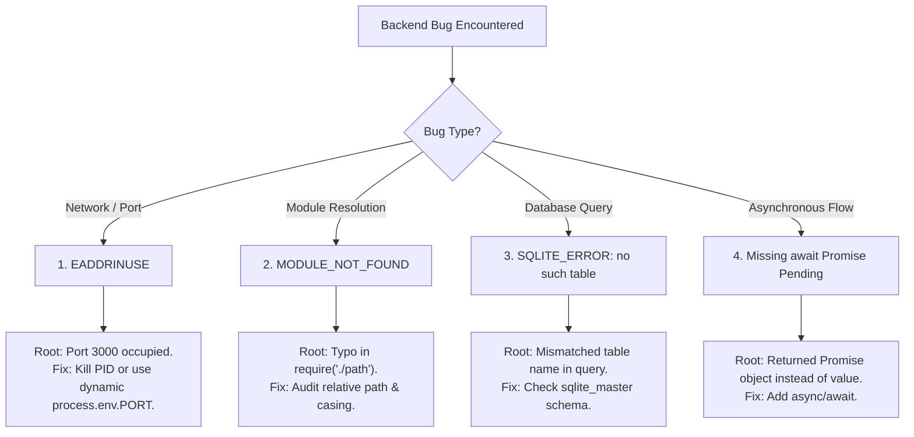

### Bug 1: `EADDRINUSE` (Address Already in Use)
- **Symptom**: Server crashes immediately on startup with `Error: listen EADDRINUSE: address already in use :::3000`.
- **Root Cause**: Another running process (such as a lingering Node instance, previous background terminal, or another service) is already bound to TCP port 3000.
- **Solution**:
  1. On Windows PowerShell, find the PID holding the port:
     ```powershell
     Get-NetTCPConnection -LocalPort 3000 | Select-Object OwningProcess
     ```
  2. Terminate the process:
     ```powershell
     Stop-Process -Id <PID> -Force
     ```
  3. Defensive code design: Always support `process.env.PORT || 3000` so host environments (or developers) can assign alternative ports on demand.

---

### Bug 2: Wrong Import Path (`MODULE_NOT_FOUND`)
- **Symptom**: Node runtime throws `Error: Cannot find module './database' Require stack: ...`.
- **Root Cause**: The string passed to `require()` has an incorrect relative path, misspelled file name, or is missing a directory change (e.g., calling `./database` from a parent folder instead of `./database`). Additionally, Linux environments (like Render) are case-sensitive, meaning `./Database.js` will fail if the file is named `./database.js`.
- **Solution**:
  1. Use `path.join(__dirname, "filename.js")` for absolute, cross-platform file paths.
  2. Verify exact directory depth (`./` vs `../`).
  3. Adhere strictly to lowercase naming conventions for files and import statements.

---

### Bug 3: SQLite Table Typo (`SQLITE_ERROR: no such table`)
- **Symptom**: Query execution rejects with `Error: SQLITE_ERROR: no such table: book`.
- **Root Cause**: The DDL script created a table named `books` (plural), but the SQL query in the route handler attempted to query `SELECT * FROM book` (singular), or the query was executed before the database initialization promise finished.
- **Solution**:
  1. Maintain consistency between DDL schema definitions and query statements.
  2. Verify existing tables directly by querying SQLite metadata:
     ```sql
     SELECT name FROM sqlite_master WHERE type='table';
     ```
  3. Ensure the server only starts listening for incoming HTTP requests *after* `initializeDB()` has resolved.

---

### Bug 4: Missing `await` on Asynchronous Database Calls
- **Symptom**: Calling `db.all()` or `db.get()` returns `Promise { <pending> }` instead of the dataset. When sent via `res.json(books)`, Express sends an empty object `{}` to the client, or subsequent synchronous code attempts to access properties on an unresolved promise resulting in `undefined` errors.
- **Root Cause**: The `sqlite` wrapper functions (`open`, `all`, `get`, `run`, `exec`) return JavaScript Promises. Omitting the `await` keyword causes execution to proceed immediately before the database returns rows.
- **Solution**:
  1. Mark route handler functions as `async (req, res, next) => { ... }`.
  2. Prepend `await` to every asynchronous call:
     ```javascript
     // Incorrect:
     const books = db.all("SELECT * FROM books");
     res.json(books); // Sends empty object or undefined!

     // Correct:
     const books = await db.all("SELECT * FROM books");
     res.json(books); // Sends populated array of books
     ```

---

## 12. Screenshot Reference Guide

The following 12 test screenshots must be captured from Postman and DB Browser for SQLite and saved into the `LAB 3/screenshots/` folder:

| # | Screenshot Identifier | Description & Endpoint | Status |
| :-: | :--- | :--- | :---: |
| **1** | `get-all-books.png` | `GET /books` returning initial 10 books | **Verified & Included** |
| **2** | `search-books.png` | `GET /books?search_q=Java` matching Java books | **Verified & Included** |
| **3** | `sort-books.png` | `GET /books?order_by=price&order=ASC` | **Verified & Included** |
| **4** | `pagination.png` | `GET /books?limit=3&offset=2` showing paginated records | **Verified & Included** |
| **5** | `price-filter.png` | `GET /books?min_price=400&max_price=700` | **Verified & Included** |
| **6** | `get-book-by-id.png` | `GET /books/1` returning single book record | **Verified & Included** |
| **7** | `post-create-book.png` | `POST /books` with 201 Created and response body | **Verified & Included** |
| **8** | `post-validation-error.png` | `POST /books` with negative price returning 400 Bad Request | **Verified & Included** |
| **9** | `put-update-book.png` | `PUT /books/:id` returning 200 OK with updated book | **Verified & Included** |
| **10**| `delete-book.png` | `DELETE /books/:id` returning 200 OK deletion confirmation | **Verified & Included** |
| **11**| `not-found-error.png` | `GET /books/9999` returning 404 Not Found | **Verified & Included** |
| **12**| `database-verification.png` | DB Browser for SQLite showing the `books` table records | **Verified & Included** |

### Visual Verification Gallery

#### 1. GET All Books (`get-all-books.png`)
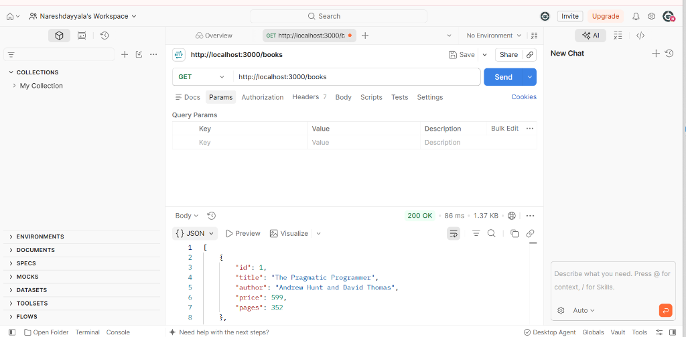
*Figure 1: Postman test verifying GET /books returning default record list.*

#### 2. Search Books (`search-books.png`)
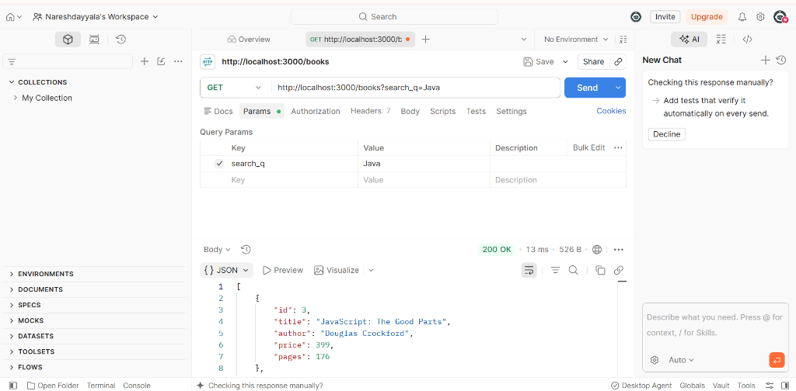
*Figure 2: Postman test verifying partial title search using search_q query parameter.*

#### 3. Sort Books by Price (`sort-books.png`)
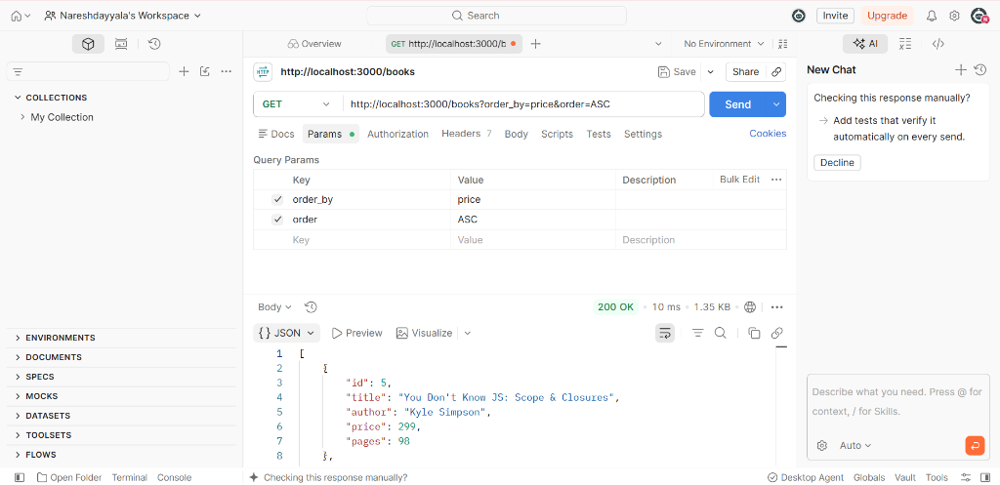
*Figure 3: Postman test showing ascending price sorting.*

#### 4. Pagination (`pagination.png`)
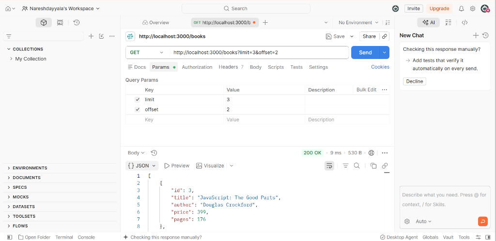
*Figure 4: Postman test showing limit and offset pagination.*

#### 5. Price Range Filter (`price-filter.png`)
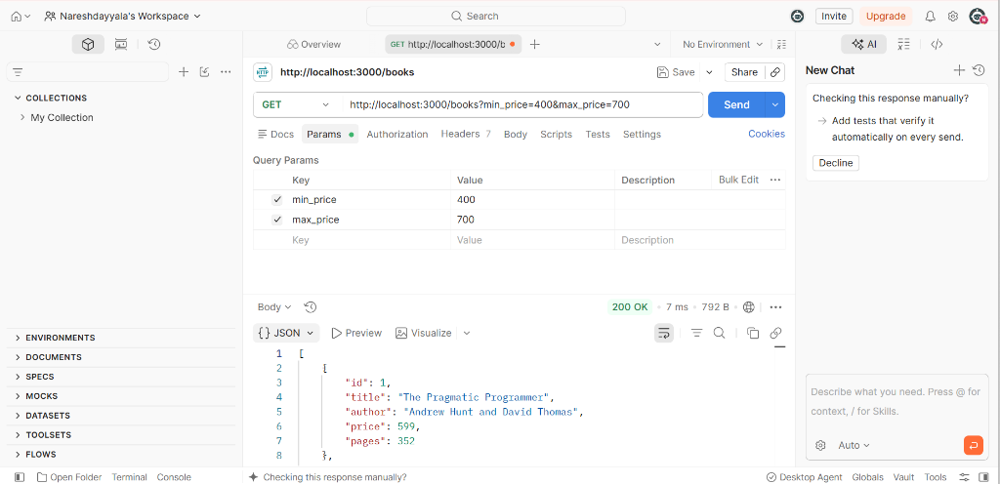
*Figure 5: Postman test showing min_price and max_price range filtering.*

#### 6. GET Book by ID (`get-book-by-id.png`)
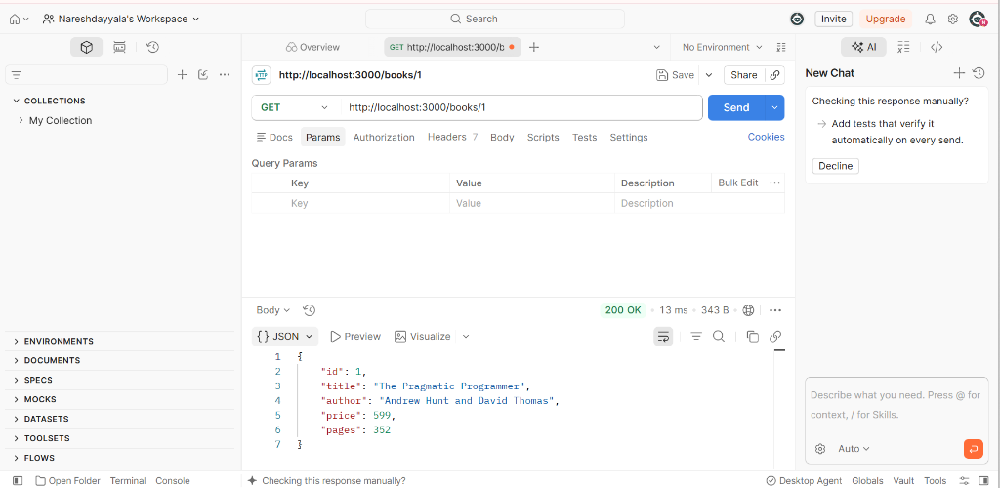
*Figure 6: Postman test retrieving single book by primary key.*

#### 7. POST Create Book (`post-create-book.png`)
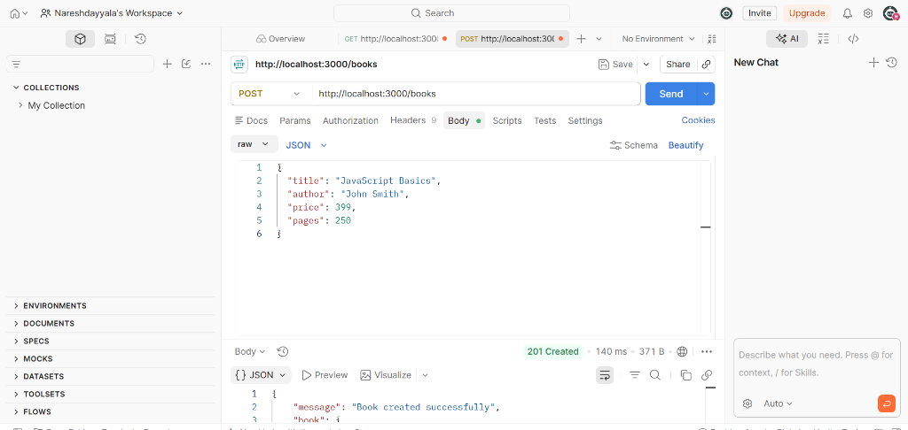
*Figure 7: Postman test verifying 201 Created status upon adding a new book.*

#### 8. POST Validation Error (`post-validation-error.png`)
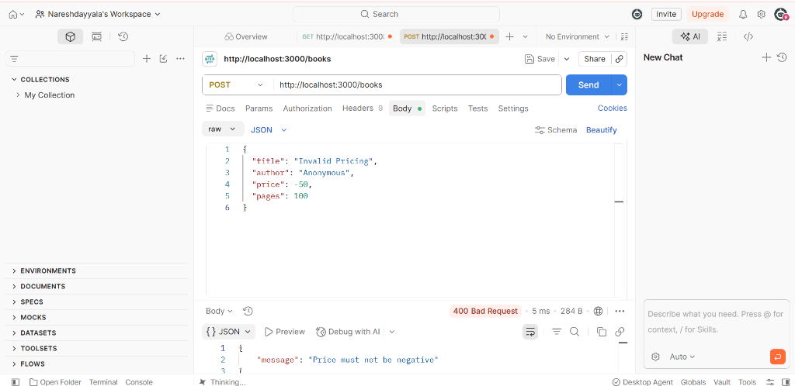
*Figure 8: Postman test showing 400 Bad Request on negative price input.*

#### 9. PUT Update Book (`put-update-book.png`)
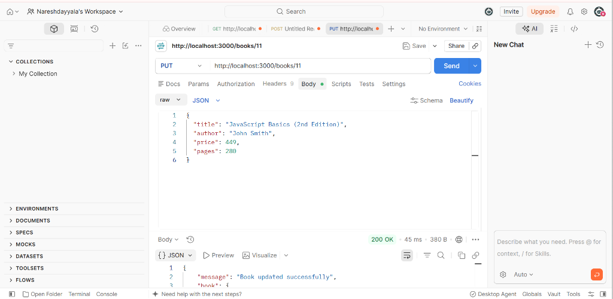
*Figure 9: Postman test showing 200 OK after updating an existing book.*

#### 10. DELETE Book (`delete-book.png`)
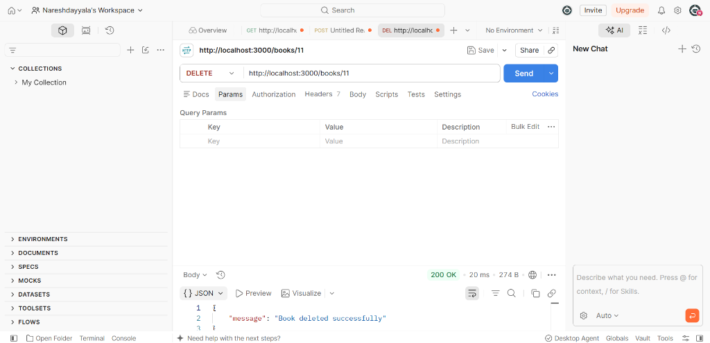
*Figure 10: Postman test confirming deletion of a book record.*

#### 11. Resource Not Found Error (`not-found-error.png`)
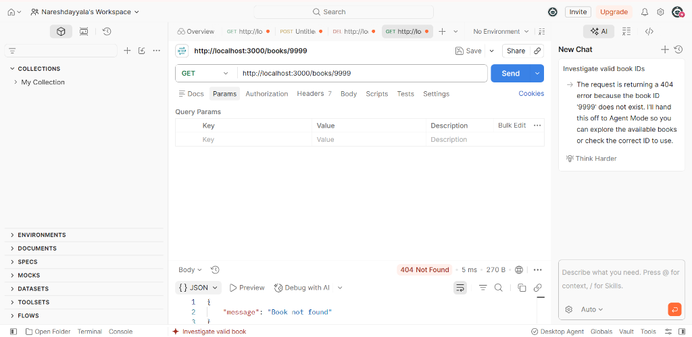
*Figure 11: Postman test showing 404 Not Found on invalid book query.*

#### 12. SQLite Database Verification (`database-verification.png`)
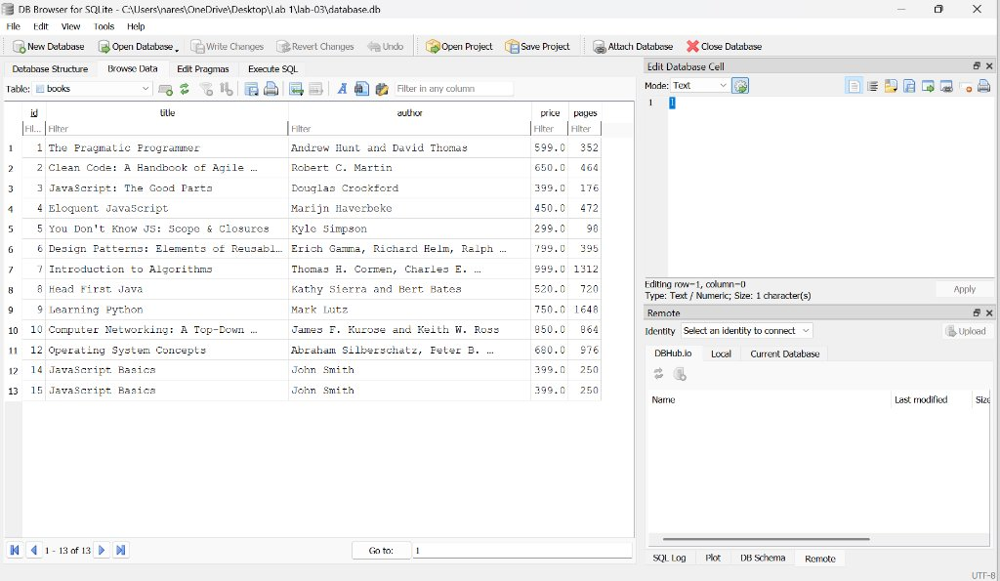
*Figure 12: DB Browser for SQLite verifying persisted records in the books table.*

---

## 13. Problems Faced & Engineering Solutions

1. **SQL Injection Risks via `ORDER BY`**:
   - *Problem*: In SQL, column identifiers (`ORDER BY column_name`) cannot be represented as parameterized `?` placeholders. Allowing raw user query input directly into the query string enables SQL injection.
   - *Solution*: Implemented an explicit allowlist `ALLOWED_SORT_COLUMNS = ['id', 'title', 'author', 'price', 'pages']`. If the user passes an unapproved identifier, the API rejects the request with a descriptive `400 Bad Request` prior to query execution.

2. **Negative and Invalid Numerical Parameters**:
   - *Problem*: Users can pass negative offsets, negative prices, or inverted price ranges (`min_price=1000&max_price=200`), leading to unpredictable queries or logical inconsistencies.
   - *Solution*: Developed a centralized validation layer that parses inputs as strict numbers, checks for `NaN`, validates non-negativity, and ensures `min_price <= max_price`.

3. **Multi-Environment Port Binding for Cloud Deployment**:
   - *Problem*: Hardcoded `localhost` or fixed port `3000` causes deployment build failures or timeout errors on cloud platforms like Render.
   - *Solution*: Configured dynamic port resolution `const PORT = process.env.PORT || 3000;` and bound the listener to `0.0.0.0` to permit external container traffic.

---

## 14. Render Deployment Instructions

To deploy Lab 3 independently to Render Web Services:

1. Log into your [Render Dashboard](https://dashboard.render.com/).
2. Click **New +** &rarr; Select **Web Service**.
3. Connect your GitHub repository: `nareshdayyala009/lab-2sqlite-crud-api`.
4. Configure the Web Service settings exactly as follows:

| Field | Value | Reason |
| :--- | :--- | :--- |
| **Name** | `lab-3-rest-api` | Unique service name on Render. |
| **Region** | Singapore / Frankfurt | Choose region closest to users. |
| **Branch** | `main` | Production branch. |
| **Root Directory** | `LAB 3` | **Critical**: Tells Render to build from the `LAB 3` subfolder. |
| **Runtime** | `Node` | Node.js runtime environment. |
| **Build Command** | `npm install` | Installs dependencies using `package-lock.json`. |
| **Start Command** | `npm start` | Executes `node app.js`. |
| **Environment Variable** | `NODE_VERSION` = `22` | Optional backup (already declared in `.node-version`). |

5. Click **Create Web Service**.
6. When deployment finishes, update the **Live URL** at the top of this `README.md` with your generated Render URL (`https://lab-3-rest-api.onrender.com`).

---

## 15. Academic Conclusion

This project successfully fulfills all academic and technical requirements for **Lab 3: REST API, Query Parameters, Validation, and Debugging**. The service provides a resilient, clean, and well-structured backend API capable of handling complex search, filtering, and CRUD operations, while enforcing strict validation and safe database interactions.

