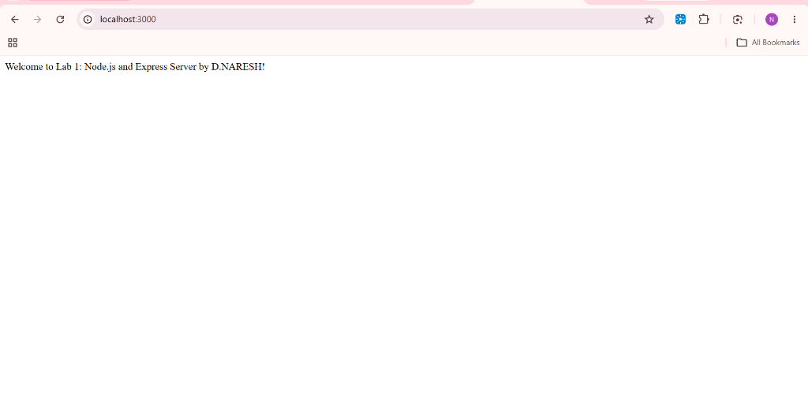
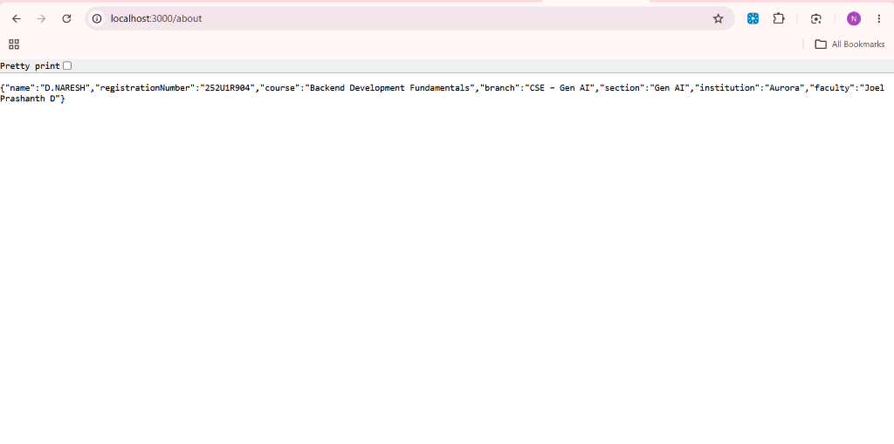
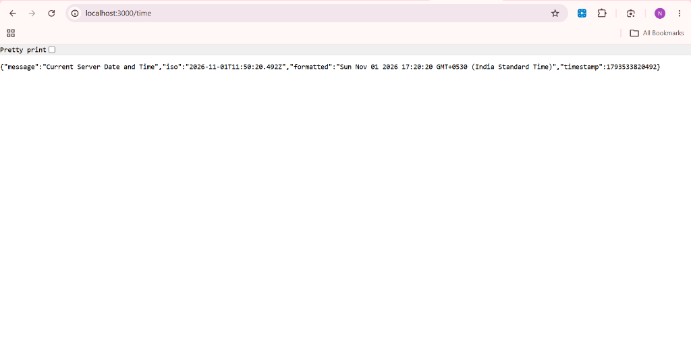
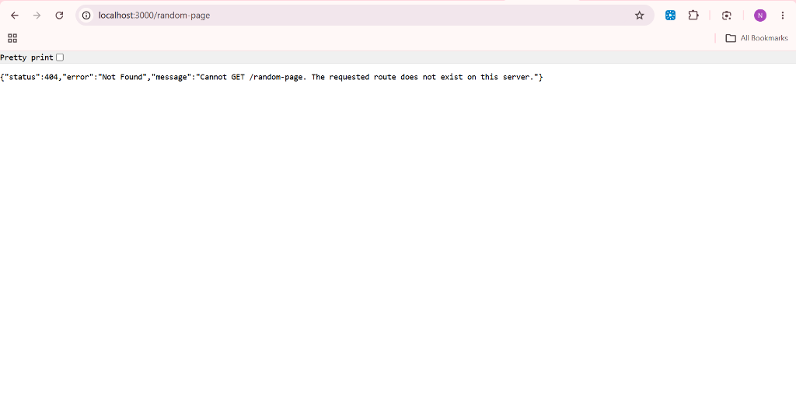
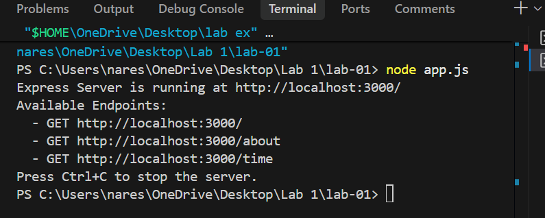

# Lab 1: Node.js and Express Server

> **Deployment Status**: *Not deployed yet (Running locally on `http://localhost:3000`)*  
> *(To deploy, see the [Deployment Guide](#how-to-deploy) below for free deployment on Render, Railway, or Vercel).*

---

## Student Details

| Attribute | Information |
| :--- | :--- |
| **Student Name** | D.NARESH |
| **Registration Number** | 252U1R904 |
| **Course** | Backend Development Fundamentals |
| **Branch** | CSE – Gen AI |
| **Section** | Gen AI |
| **Institution** | Aurora |
| **Faculty In-Charge** | Joel Prashanth D |

---

## Table of Contents

1. [Lab Number and Title](#1-lab-number-and-title)
2. [Student Details](#2-student-details)
3. [Project Introduction](#3-project-introduction)
4. [Objectives](#4-objectives)
5. [Technologies Used](#5-technologies-used)
6. [Project Folder Structure](#6-project-folder-structure)
7. [Installation Instructions](#7-installation-instructions)
   - [Understanding package.json](#understanding-packagejson)
   - [Understanding node_modules and package-lock.json](#understanding-node_modules-and-package-lockjson)
8. [How to Run the Plain Node.js HTTP Server](#8-how-to-run-the-plain-nodejs-http-server)
9. [How to Run the Express Server](#9-how-to-run-the-express-server)
10. [API Endpoint Documentation](#10-api-endpoint-documentation)
11. [Request and Response Examples](#11-request-and-response-examples)
12. [Screenshots](#12-screenshots)
13. [Problems Faced and Solutions](#13-problems-faced-and-solutions)
14. [Learning Outcomes](#14-learning-outcomes)
15. [Viva Questions and Answers](#15-viva-questions-and-answers)
16. [How to Deploy](#how-to-deploy)
17. [Conclusion](#17-conclusion)

---

## 1. Lab Number and Title

- **Lab Assignment**: Lab 1
- **Title**: Node.js and Express Server Development

---

## 2. Student Details

- **Name**: D.NARESH
- **Hall Ticket / Reg No**: 252U1R904
- **Branch**: B.Tech CSE (Artificial Intelligence & Machine Learning / Gen AI)
- **College**: Aurora

---

## 3. Project Introduction

Backend web development begins with understanding how a server receives client requests over HTTP and responds with data. In this lab, we build two foundational types of servers in JavaScript:

1. **Plain Node.js Server (`server.js`)**: Uses Node.js's standard built-in `http` module (`http.createServer()`) to handle raw HTTP connections without any third-party frameworks.
2. **Express.js Application (`app.js`)**: Uses **Express.js**, the industry-standard web framework, to create clean, modular REST endpoints, parse query data, handle routing logic, send structured JSON responses, and gracefully intercept invalid endpoints with `404 Not Found` handlers.

---

## 4. Objectives

- [x] Initialize a Node.js project environment using npm (`package.json`).
- [x] Understand the purpose of `package.json`, `package-lock.json`, and `node_modules/`.
- [x] Create a demonstration HTTP server using Node.js's built-in `http` module listening on port 3000.
- [x] Install and configure Express.js (`npm install express`).
- [x] Build an Express server with flexible port allocation (`process.env.PORT || 3000`).
- [x] Implement the following endpoints:
  - `GET /` &mdash; Welcome text response (Status 200).
  - `GET /about` &mdash; Student and course metadata in JSON format (Status 200).
  - `GET /time` &mdash; Dynamic server date and time using `new Date()` (Status 200).
  - Wildcard / Catch-All &mdash; Proper 404 JSON response for undefined routes (Status 404).
- [x] Test and verify all endpoints using web browsers, curl, or Postman.
- [x] Prepare comprehensive documentation and viva voce review answers.

---

## 5. Technologies Used

| Technology | Purpose |
| :--- | :--- |
| **Node.js** | Server-side JavaScript runtime engine executing our backend logic. |
| **Express.js** | High-performance, minimalist Node.js web application framework for routing and middleware. |
| **Node HTTP Module** | Standard native library used to build the low-level plain HTTP demonstration server. |
| **npm (Node Package Manager)** | Package management system used to install, manage, and track project dependencies. |
| **Git** | Version control system used for tracking code iterations. |
| **Postman / Browser** | Client tools used for sending HTTP requests and inspecting status codes and response headers. |

---

## 6. Project Folder Structure

```text
lab-01/
├── screenshots/               # Folder for holding test execution screenshots
│   ├── welcome.png            # GET / response in browser or Postman
│   ├── about.png              # GET /about JSON response
│   ├── time.png               # GET /time dynamic timestamp response
│   ├── not-found-404.png      # 404 response for unknown routes
│   └── terminal-running.png   # Terminal showing server running
├── .gitignore                 # Specifies files ignored by Git (node_modules, .env)
├── app.js                     # Express.js server implementation with all 4 endpoints
├── package-lock.json          # Dependency lockfile ensuring reproducible package builds
├── package.json               # Project manifest, metadata, scripts, and dependencies
├── server.js                  # Plain Node.js HTTP module demonstration server
└── README.md                  # Comprehensive Lab 1 documentation
```

---

## 7. Installation Instructions

### Prerequisites
- Install **Node.js** (v18.x or later) from [nodejs.org](https://nodejs.org/).
- Verify installation in your terminal:
  ```bash
  node -v
  npm -v
  ```

### Step-by-Step Installation

1. Navigate into the `lab-01` directory:
   ```bash
   cd lab-01
   ```

2. Install dependencies:
   ```bash
   npm install
   ```
   *(This will read `package.json` and download `express` into `node_modules`.)*

---

### Understanding package.json

`package.json` is the manifest file of any Node.js project. It contains essential configuration details:

- **`name`**: The identifier of the project (e.g., `"lab-01"`).
- **`version`**: Current semantic version of the application (`"1.0.0"`).
- **`description`**: A short summary explaining what this package or project does.
- **`main`**: The entry point file of the application (`"app.js"`).
- **`scripts`**: Command-line shortcuts configured for running the project:
  - `"start": "node app.js"` &mdash; starts the Express server.
  - `"http-server": "node server.js"` &mdash; starts the plain HTTP server.
- **`keywords`**: Search tags describing the application.
- **`author`**: Student attribution (`"D.NARESH (252U1R904)"`).
- **`license`**: Legal licensing terms under which code is distributed (`"ISC"`).
- **`dependencies`**: The third-party packages installed via npm required for the app to execute (e.g., `"express": "^5.3.0"`).

---

### Understanding node_modules and package-lock.json

- **`node_modules/`**:
  - A directory created automatically by npm when you run `npm install`.
  - It holds the actual source code and binaries of Express and all of Express's internal sub-dependencies.
  - **Why it is NOT committed to Git**: It contains thousands of files and takes hundreds of megabytes. Because anyone can recreate it by simply running `npm install`, it is excluded via `.gitignore`.

- **`package-lock.json`**:
  - Automatically generated by npm when packages are modified or installed.
  - Records the exact versions, integrity hashes, and resolution paths for every single downloaded package.
  - **Why it IS committed to Git**: It guarantees that every developer, server, or grading faculty gets the exact same dependencies down to the exact patch version, eliminating the *"it works on my machine"* problem.

---

## 8. How to Run the Plain Node.js HTTP Server

The plain HTTP server demonstrates how Node.js communicates over HTTP using only its core built-in library.

### Starting the Server
From inside the `lab-01` folder, run:
```bash
npm run http-server
```
*or directly:*
```bash
node server.js
```

### Terminal Output
```text
Plain Node.js HTTP Server is running at http://localhost:3000/
Press Ctrl+C to stop the server.
```

### Testing the Server
- Open your browser or Postman and visit:
  ```text
  http://localhost:3000/
  ```
- **Response**: `Hello` (Plain Text, Status: `200 OK`)
- Stop the server with `Ctrl + C`.

---

## 9. How to Run the Express Server

The Express server in `app.js` handles routing, structured JSON responses, and 404 error handling.

### Starting the Server
From inside the `lab-01` folder, run:
```bash
npm start
```
*or directly:*
```bash
node app.js
```

### Terminal Output
```text
Express Server is running at http://localhost:3000/
Available Endpoints:
  - GET http://localhost:3000/
  - GET http://localhost:3000/about
  - GET http://localhost:3000/time
Press Ctrl+C to stop the server.
```

### Custom Port Support
You can run the server on any custom port using an environment variable:
```bash
PORT=5000 npm start
```
*(On Windows PowerShell: `$env:PORT=5000; node app.js`)*

---

## 10. API Endpoint Documentation

| Method | Endpoint | Description | Content-Type | Status Code |
| :---: | :--- | :--- | :--- | :---: |
| **GET** | `/` | Returns welcome message | `text/html; charset=utf-8` | `200 OK` |
| **GET** | `/about` | Returns student details and section in JSON | `application/json; charset=utf-8` | `200 OK` |
| **GET** | `/time` | Returns dynamic current server date & time | `application/json; charset=utf-8` | `200 OK` |
| **ALL** | `/*` *(unknown)* | Handles any unmapped route | `application/json; charset=utf-8` | `404 Not Found` |

---

## 11. Request and Response Examples

### Endpoint 1: GET `/`
- **Request**:
  ```http
  GET / HTTP/1.1
  Host: localhost:3000
  ```
- **Status Code**: `200 OK`
- **Response Body**:
  ```text
  Welcome to Lab 1: Node.js and Express Server by D.NARESH!
  ```

---

### Endpoint 2: GET `/about`
- **Request**:
  ```http
  GET /about HTTP/1.1
  Host: localhost:3000
  ```
- **Status Code**: `200 OK`
- **Response Body**:
  ```json
  {
    "name": "D.NARESH",
    "registrationNumber": "252U1R904",
    "course": "Backend Development Fundamentals",
    "branch": "CSE – Gen AI",
    "section": "Gen AI",
    "institution": "Aurora",
    "faculty": "Joel Prashanth D"
  }
  ```

---

### Endpoint 3: GET `/time`
- **Request**:
  ```http
  GET /time HTTP/1.1
  Host: localhost:3000
  ```
- **Status Code**: `200 OK`
- **Response Body**:
  ```json
  {
    "message": "Current Server Date and Time",
    "iso": "2026-11-01T11:43:16.404Z",
    "formatted": "Sun Nov 01 2026 17:13:16 GMT+0530 (India Standard Time)",
    "timestamp": 1793533396404
  }
  ```

---

### Endpoint 4: Unknown Route (e.g. GET `/random-page`)
- **Request**:
  ```http
  GET /random-page HTTP/1.1
  Host: localhost:3000
  ```
- **Status Code**: `404 Not Found`
- **Response Body**:
  ```json
  {
    "status": 404,
    "error": "Not Found",
    "message": "Cannot GET /random-page. The requested route does not exist on this server."
  }
  ```

---

## 12. Screenshots

*Note: Save your actual screenshots in the `lab-01/screenshots/` folder with the filenames listed below:*

### 1. GET / Welcome Response
Displays the welcome text in the browser / Postman.  


### 2. GET /about JSON Response
Displays student name, registration number, course, and section.  


### 3. GET /time Response
Displays dynamic server date and timestamp.  


### 4. 404 Not Found Response
Displays custom 404 error response when accessing an undefined endpoint.  


### 5. Server Running in Terminal
Terminal view showing the server active on port 3000.  


---

## 13. Problems Faced and Solutions

| # | Problem Faced | Root Cause | Solution Implemented |
| :-: | :--- | :--- | :--- |
| **1** | Port 3000 already in use (`EADDRINUSE`). | Another process (e.g., an earlier server instance) was already occupying port 3000. | Added flexible port selection (`process.env.PORT || 3000`) and closed prior processes using `Ctrl + C` or PowerShell `Stop-Process`. |
| **2** | Default Express 404 returns plain HTML instead of JSON. | Standard Express returns `Cannot GET /route` as HTML when no handler matches. | Added a catch-all middleware (`app.use((req, res) => {...})`) at the end of the route definitions to return structured JSON. |
| **3** | Committing bulky dependencies to Git repository. | Forgetting to ignore `node_modules` causes repositories to balloon in size. | Created `.gitignore` in both parent and `lab-01/` directories explicitly listing `node_modules/` and `.env`. |
| **4** | Dynamic cloud platforms failing to bind to port 3000. | Cloud providers (Render, Heroku, AWS) assign dynamic ports via `process.env.PORT`. | Configured `const PORT = process.env.PORT || 3000` to seamlessly work in both local and hosted environments. |

---

## 14. Learning Outcomes

Completing this lab assignment provided hands-on expertise in the following backend principles:

1. **Client-Server Architecture**: Understanding how clients (browsers, Postman) issue HTTP requests with methods (`GET`) and paths, and how servers process them to return status codes and payloads.
2. **HTTP vs Express.js Comparison**: Appreciating how Express simplifies request handling, URL parameter extraction, and status management compared to Node's lower-level `http` module.
3. **HTTP Status Codes in REST APIs**: Correct usage of `200 OK` for valid queries and `404 Not Found` for nonexistent resources.
4. **Environment Variables**: Leveraging `process.env.PORT` for portable application hosting.
5. **Modern JavaScript Asynchrony & Modularity**: Organizing clean code using ES6 syntax, modular imports, and middleware chaining.

---

## 15. Viva Questions and Answers

### Q1: What is Node.js?
**Answer**: Node.js is an open-source, cross-platform JavaScript runtime environment built on Google Chrome's V8 JavaScript engine. It allows developers to execute JavaScript code on the server side, outside of a web browser.

### Q2: What is Express.js, and why do we use it over the core `http` module?
**Answer**: Express.js is a minimal and flexible web application framework for Node.js. While the built-in `http` module requires manually parsing URLs, handling streams, setting headers, and routing paths with complex `if/else` checks, Express provides convenient built-in routing (`app.get()`), middleware support, simple JSON helpers (`res.json()`), and cleaner syntax.

### Q3: What is the difference between `package.json` and `package-lock.json`?
**Answer**:
- `package.json` contains high-level project metadata and specifies semantic version ranges (e.g., `^5.3.0`) of required dependencies.
- `package-lock.json` records the exact version of every installed dependency and sub-dependency along with integrity check hashes, ensuring that any developer running `npm install` gets the identical dependency tree.

### Q4: Why should `node_modules` never be pushed to a Git repository?
**Answer**: The `node_modules` folder contains thousands of downloaded files and can be very large (hundreds of MBs). Since all dependencies are documented in `package.json`, any user can recreate the entire folder in seconds using `npm install`. Storing it in Git creates unnecessary repository bloat and merge conflicts.

### Q5: What does `process.env.PORT || 3000` mean?
**Answer**: It is a logical OR fallback expression. When deployed to a cloud platform (like Render or AWS), the hosting environment provides a dynamic port number through the environment variable `process.env.PORT`. When running locally on a personal computer where that variable is unset, JavaScript falls back to the default port `3000`.

### Q6: What is the difference between status code `200` and `404`?
**Answer**:
- **`200 OK`**: Indicates that the client's request succeeded and the server has returned the expected resource or data.
- **`404 Not Found`**: Indicates that the server could not find the specific resource or URL route requested by the client.

### Q7: What is middleware in Express?
**Answer**: Middleware functions are functions that have access to the request object (`req`), the response object (`res`), and the `next` function in the application’s request-response cycle. They can execute code, modify `req` and `res`, end the request-response cycle, or call `next()` to pass control to the next handler.

---

## How to Deploy

To deploy this Express application online for free:

### Option A: Render (Recommended)
1. Push your repository to GitHub.
2. Sign in to [render.com](https://render.com/) and click **New + > Web Service**.
3. Connect your GitHub repository.
4. Configure the settings:
   - **Root Directory**: `lab-01`
   - **Build Command**: `npm install`
   - **Start Command**: `node app.js`
5. Click **Create Web Service**. Render will assign a public live URL (e.g., `https://lab-01-naresh.onrender.com`).
6. Update the deployment URL at the top of this README once live.

---

## 17. Conclusion

Lab 1 successfully introduces the fundamentals of backend development in Node.js. Both a low-level plain HTTP server and an Express.js server were constructed, tested, and verified. The Express application cleanly fulfills all routing requirements (`/`, `/about`, `/time`, and 404 handling) with appropriate HTTP status codes, robust environment variable handling, and clean documentation.

---

*Submitted by: **D.NARESH** (Reg No: `252U1R904`) | Aurora College | Faculty: Joel Prashanth D*

